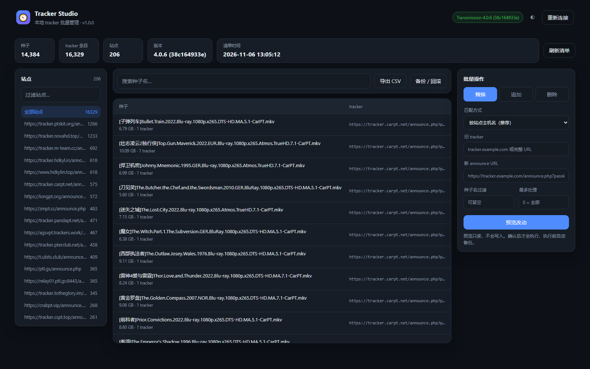
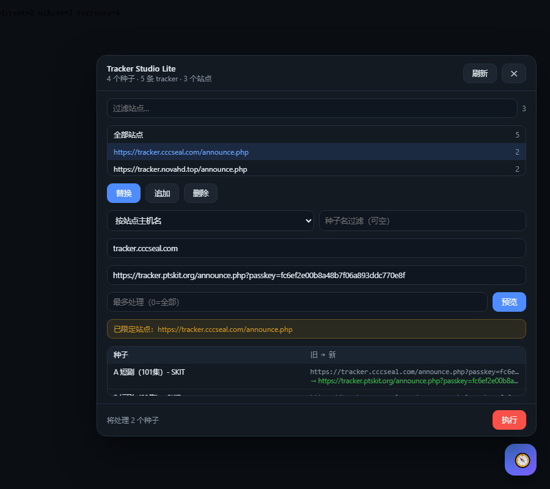

# Tracker Studio

**本地 Web 界面的 BT tracker 批量管理工具** —— 把「14000 个种子里的某条 tracker 换掉」变成三步：看清单 → 预览 → 执行。

不依赖第三方库，只需要 Python 3.9+。不用装 Node、不用 npm、不用 pip。




## 两种用法

### A. 篡改猴脚本（推荐，零部署）

`serscript/tracker-studio-lite.user.js` —— 直接注入 Transmission Web 页面，右下角一个 🧭 按钮（或 `Ctrl+Alt+T`）。

装法：打开 Tampermonkey 面板 → **添加新脚本** → 粘贴文件内容 → 保存；或者把 `.user.js` 文件直接拖进 Tampermonkey 的管理面板，它会弹安装页。

匹配 `*://*/transmission/web/*`，所以在 `http://你的盒子:9091/transmission/web/` 上会自动生效。RPC 地址由当前页面路径推导（`/transmission/web` → `/transmission/rpc`），登录状态沿用浏览器里已有的 Basic Auth。



### B. 独立 Web 应用

`python tracker_studio.py --open`，见上文。

## 为什么不用现成的

`transmission-web-control` 的「批量替换 tracker」是一个对话框，一次一个种子。这个工具面向**成规模的站点迁移**：

- 先把所有 tracker 聚合成「站点 → 种子数」，一眼看出哪些站有几万个种子
- 改动先生成**逐条 diff 计划**（哪个种子、哪条旧 URL、换成什么），确认后才写
- 每次写入**自动备份**，界面上一键回滚
- 兼容 Transmission 4.0 与 4.1 的 API 差异，写入失败自动换写法

## 快速开始

```bash
python tracker_studio.py --open
```

浏览器打开 `http://127.0.0.1:8787`，然后：

1. **连接客户端**：填 RPC 地址（Transmission 默认 `http://127.0.0.1:9091/transmission/rpc`）
2. **刷新清单**：拉取所有种子与 tracker（14000 个种子约 2 秒）
3. 左侧点一个**站点**筛出这批种子，右侧选操作、填新旧 URL
4. **预览改动** → 检查 diff → **确认执行**

## 功能

| 能力 | 说明 |
|---|---|
| 三种操作 | `替换` 单条 tracker / `追加` 新 tracker / `删除` 指定 tracker |
| 四种匹配 | 按站点主机名（推荐）、完整 URL 精确、包含片段（换 passkey）、正则 |
| 精确操作 | 只改命中的那条 tracker，同种子的其它 tracker 与 tier 层级原样保留 |
| 影响面 | 站点过滤 + 种子名过滤 + 数量上限，先小批量试水 |
| 预览 | 逐条列出 种子 / 原 URL / 新 URL，带重复与上限警告 |
| 进度 | 实时进度条 + 失败项逐条列出 |
| 备份回滚 | 执行前自动落盘 JSON，可下载、可一键回滚 |
| 清单导出 | CSV（passkey 自动打码） |
| 主题 | 深色 / 浅色，选择记在 localStorage |

## 支持客户端

| 客户端 | 状态 | 说明 |
|---|---|---|
| Transmission 2.10+ | ✅ | 4.0.x 用 `trackerReplace`；4.1+ 拒绝细粒度接口时自动回退 `trackerList` |
| qBittorrent 4.x / 5.x | ⚠️ 基础 | 只处理每个种子的**主 tracker**；多种子多 tracker 的场景请在客户端里核对 |
| 其它 | ❌ | 欢迎 PR |

## 安全

- 凭据只存在后端进程内存，**不写磁盘**
- 执行前自动备份到 `backups/`，回滚依据就是它
- 界面只监听 `127.0.0.1`，不要改成 `0.0.0.0` 暴露到公网
- 导出 CSV 与备份里的 passkey 会打码 / 保留原值，请自行注意保管

## HTTP API

界面用的就是这组接口，可以脚本化调用：

| 方法 | 路径 | 说明 |
|---|---|---|
| POST | `/api/connect` | `{kind,url,username,password,insecure}` |
| POST | `/api/refresh` | 重新拉取清单 |
| GET | `/api/summary` | 种子数 / tracker 数 / 站点聚合 |
| GET | `/api/search?q=&host=&limit=&offset=` | 种子分页 |
| POST | `/api/plan` | `{mode,match,old,new,nameFilter,hostFilter,limit}` → 改动计划 |
| POST | `/api/apply` | `{planId}` → 任务 |
| GET | `/api/job/<id>` | 任务进度 / 失败项 |
| GET | `/api/backups`、POST `/api/rollback` | 备份与回滚 |
| GET | `/api/export.csv` | 导出清单 |

## 测试

```bash
python tests/smoke_test.py
```

内置假 Transmission RPC，覆盖：连接 → 清单 → 预览 → 执行 → 校验（旁路 tracker / tier 不丢）→ 回滚 → 再次校验。13 项断言，不需要真实客户端。

## 限制

- 清单存在内存，重启进程要重新连接
- 单文件上限默认 45 MB 的场景与本工具无关（不处理种子文件本体）
- 不做种子增删、限速、文件优先级——只做 tracker

## 作者

Nocile · [@nocile3210-ctrl](https://github.com/nocile3210-ctrl)

## License

MIT

